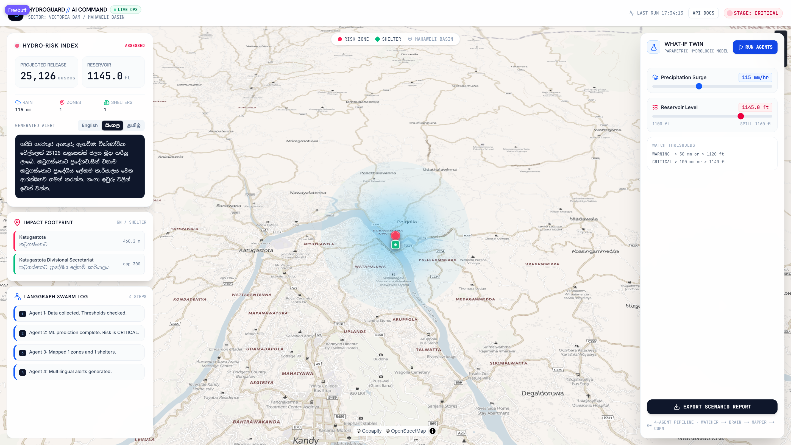
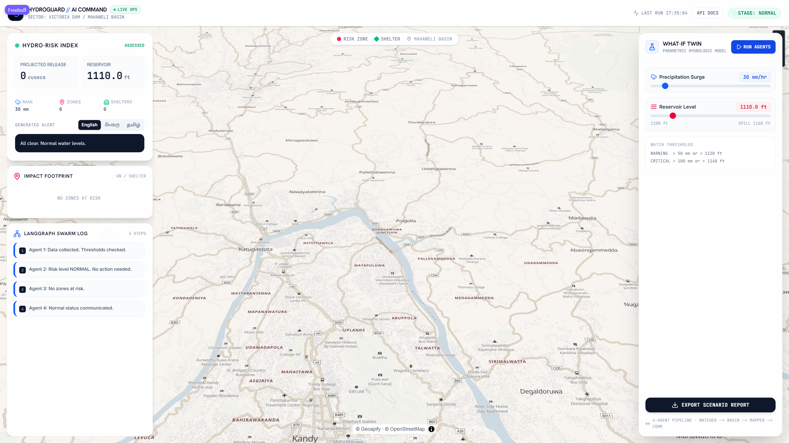
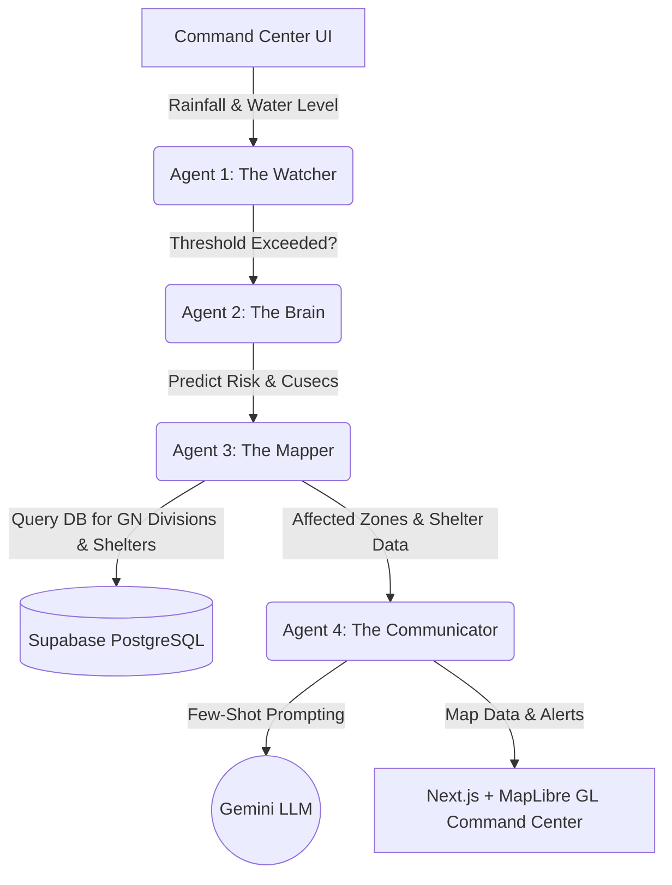

# 🌊 HydroGuard AI: Autonomous Multi-Agent Flood Command Center

[](https://fastapi.tiangolo.com/)
[](https://langchain-ai.github.io/langgraph/)
[](https://nextjs.org/)
[](https://maplibre.org/)

An end-to-end, AI-powered early-warning and emergency response platform designed to mitigate flash flooding downstream of the Victoria Dam, Sri Lanka. Instead of relying on slow, manual announcements, **HydroGuard AI** uses a stateful Multi-Agent System to predict dam spill-gate releases, map exact flood zones, and dispatch personalized, multilingual evacuation alerts in real-time via a sci-fi-inspired Command Center UI.

---

## 📸 Preview

| CRITICAL (115 mm / 1145 ft → 25,126 cusecs) | NORMAL (30 mm / 1110 ft) |
| :---: | :---: |
|  |  |

---

## 🚨 The Problem
During heavy monsoons, sudden water releases from the Victoria Dam cause rapid flash flooding in downstream communities (e.g., Tennekumbura, Katugastota, Peradeniya). Current warning systems are often manual, generic, and lack precise, multilingual evacuation guidance in native scripts (Sinhala/Tamil).

## 💡 The Solution
HydroGuard AI orchestrates four specialized AI agents that work together in real-time:
1. **The Watcher**: Monitors live rainfall and dam telemetry against safety thresholds.
2. **The Brain**: Runs an XGBoost machine learning model to predict spill-gate release volumes (in cusecs) and assign a risk level (Normal, Warning, Critical).
3. **The Mapper**: Queries a PostgreSQL database to identify affected Grama Niladhari (GN) divisions and locate the nearest safe shelters.
4. **The Communicator**: Uses few-shot prompting to generate calm, grammatically correct emergency alerts in English, Sinhala, and Tamil, complete with accurate native-script place names.

---

## 🏗️ System Architecture



---

## 🦸 Engineering Highlights & "Super Tricks"

* **Synthetic Data ML Training**: Due to the scarcity of public historical spill data, the XGBoost model was trained on a 5,000-row synthetic hydrological dataset. To prevent data leakage and simulate real-world sensor variance, **5% stochastic noise** was injected into the training labels, resulting in a robust, generalizable accuracy of ~96%.
* **Flawless Multilingual Rendering**: Base LLMs often hallucinate South Asian scripts. By combining strict few-shot prompting with dedicated `Noto Sans Sinhala/Tamil` web fonts, the system guarantees grammatically correct, panic-free alerts with perfect conjunct rendering (e.g., "කටුගස්තොට" instead of broken transliteration).
* **Resilient Fallback Architecture**: The LangGraph workflow includes `try/except` blocks and heuristic fallbacks. If the LLM API rate-limits, the system degrades gracefully to default safe alerts rather than crashing the pipeline.

---

## 🛠️ Tech Stack

| Category | Technologies |
| :--- | :--- |
| **Agent Orchestration** | LangGraph 1.x, LangChain Core, Pydantic |
| **Machine Learning** | Python, XGBoost, Scikit-Learn, Pandas, Joblib |
| **Backend API** | FastAPI, Uvicorn, Psycopg2 (PostgreSQL IPv4 Pooler) |
| **Frontend & Maps** | Next.js 16, React 19, Tailwind CSS v4, MapLibre GL, Geoapify |
| **Database** | Supabase (PostgreSQL) |
| **Runtime** | Bun (Production), Python 3.10+ venv |

---

## 🚀 Quick Start Guide

### Prerequisites
- Python 3.10+ 
- [Bun](https://bun.sh/) (Recommended for Next.js frontend)

### 1. Backend Setup
```bash
git clone https://github.com/<your-username>/hydroguard-ai.git
cd hydroguard-ai/backend

python -m venv venv
source venv/bin/activate  # On Windows: venv\Scripts\activate
pip install -r requirements.txt

cp .env.example .env
# Add your GOOGLE_API_KEY and DATABASE_URL to .env

uvicorn main:app --reload
```
*Backend will be available at `http://127.0.0.1:8000` (Visit `/docs` for Swagger UI)*

### 2. Frontend Setup
```bash
cd ../frontend
bun install

cp .env.example .env.local
# Add your NEXT_PUBLIC_GEOAPIFY_KEY and NEXT_PUBLIC_API_URL

bun run build
bun run start
```
*Frontend will be available at `http://127.0.0.1:3000`*

> **Note:** Due to known HMR WebSocket handshake issues when running `next dev` under Bun, it is highly recommended to use `bun run build && bun run start` for local testing. 

---

## ⚠️ Known Limitations & Phase 2 Roadmap

As an honest engineering project, the following limitations are documented for transparency:

1. **Map Rendering**: The current frontend uses Geoapify raster tiles via MapLibre GL. While highly reliable and token-friendly, it does not support extruded 3D terrain. *Phase 2*: Integrate Cesium.js or Mapbox 3D terrain when institutional API quotas allow.
2. **ML Inflow Estimation**: The XGBoost model currently uses a heuristic correlation (`rainfall_mm * 50`) to estimate inflow rate. *Phase 2*: Integrate real-time IoT sensor telemetry APIs from the Mahaweli Authority for true live inflow data.
3. **Alert Dispatch**: Currently, alerts are generated and displayed in the Command Center UI. *Phase 2*: Integrate Telegram Bot API and Twilio for automated, real-world push notifications to registered citizens.

---

## 📄 Academic & Portfolio Value
This project demonstrates end-to-end AI engineering, combining predictive ML, stateful multi-agent workflows, geospatial mapping, and real-world social impact. It is structured to serve as a foundation for an IEEE/conference paper comparing autonomous multi-agent coordination against traditional manual warning systems in reducing evacuation response times.

**Author**: Upamada Ekanayake  
**License**: MIT
