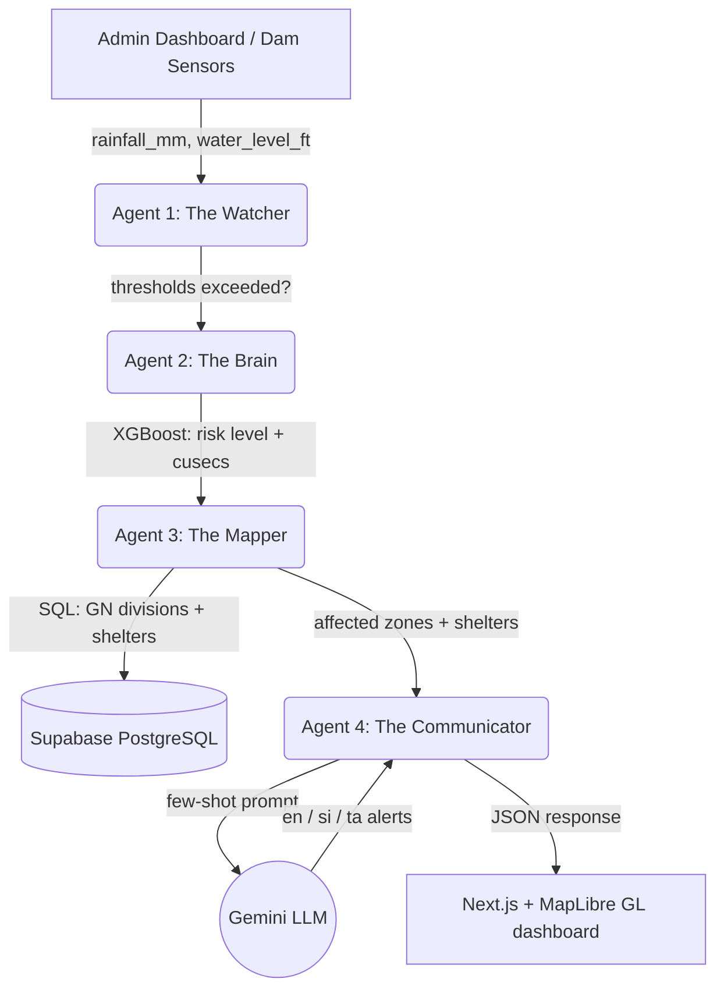

# 🌊 HydroGuard AI: Autonomous Multi-Agent Flood Prediction & Evacuation System

[](https://fastapi.tiangolo.com/)
[](https://langchain-ai.github.io/langgraph/)
[](https://nextjs.org/)
[](https://xgboost.readthedocs.io/)
[](https://bun.sh/)

An end-to-end, AI-powered early-warning and emergency response platform designed to mitigate flash flooding downstream of the Victoria Dam, Sri Lanka. Instead of relying on slow, manual announcements, **HydroGuard AI** uses a stateful Multi-Agent System (LangGraph) to predict dam spill-gate releases, map exact flood zones, and dispatch personalized, multilingual evacuation alerts in real time.

---

## 🚨 The Problem

During heavy monsoon rains, the Victoria Dam must open its spill gates to prevent structural overflow. Sudden, large-volume water releases into the Mahaweli River cause rapid flash flooding in downstream communities (e.g., Tennekumbura, Katugastota, Peradeniya). Current warning methods are often slow, generic, and fail to give residents specific evacuation instructions in their own languages (Sinhala / Tamil).

## 💡 The Solution

HydroGuard AI orchestrates four specialized agents that cooperate in one pipeline:

1. **The Watcher** — validates incoming rainfall and reservoir telemetry against safety thresholds.
2. **The Brain** — runs XGBoost models to predict spill-gate release volume (cusecs) and assign a risk level (Normal, Warning, Critical).
3. **The Mapper** — queries PostgreSQL for affected Grama Niladhari (GN) divisions and the shelters serving them.
4. **The Communicator** — generates calm, grammatically correct emergency alerts in English, Sinhala and Tamil, using native-script place names.

---

## 🏗️ System Architecture



The backend exposes the whole run over one HTTP call:

| Endpoint | Purpose |
| :--- | :--- |
| `GET /` | Liveness message |
| `GET /status` | API + dam status |
| `GET /test-db` | Connectivity check against `gn_divisions` |
| `POST /run-agents` | Runs the 4-agent pipeline; body is optional |

```bash
curl -X POST http://127.0.0.1:8000/run-agents \
  -H "Content-Type: application/json" \
  -d '{"rainfall_mm": 105.0, "current_water_level": 1135.0}'
```

Returns `final_risk_level`, `estimated_cusecs`, `affected_areas`, `safe_shelters`, `multilingual_alerts` (`en` / `si` / `ta`) and a step-by-step `agent_log`. Omitting the body falls back to the default demo scenario.

---

## 🦸 "Super Tricks" & Engineering Highlights

* **Synthetic data with deliberate label noise** — public historical spill data for the Victoria Dam is not available, so the models are trained on 5,000 generated hydrological scenarios. The labels are derived from explicit hydrological rules, which the model would otherwise memorise: injecting **5% stochastic label noise** drops training-set leakage and yields a generalisable ~96% classifier accuracy with a cusecs MAE in the low thousands.
* **Few-shot multilingual prompting** — base LLMs mix scripts and produce unnatural Sinhala/Tamil under pressure. Strict few-shot examples in the system prompt produce grammatically correct, panic-free alerts with accurate native-script names (e.g. "කටුගස්තොට" rather than Latin "Katugastota"), with English fallback when a translation column is missing.
* **Fail-soft by design** — the graph, the LLM call and the model loading are all individually guarded. A missing `.pkl`, a retired Gemini model or a rate-limit degrades to heuristic text/values instead of crashing the API mid-disaster. The model name is env-configurable (`GEMINI_MODEL`) precisely because Google retires models frequently.

---

## 🛠️ Tech Stack

| Category | Technologies |
| :--- | :--- |
| **Agent orchestration** | LangGraph 1.x, LangChain Core, Pydantic |
| **Machine learning** | Python, XGBoost, scikit-learn, pandas, joblib |
| **Backend API** | FastAPI, Uvicorn, Psycopg2 (Supabase IPv4 pooler) |
| **Frontend & maps** | Next.js 16, React 19, Tailwind CSS v4, MapLibre GL, Geoapify |
| **Database** | Supabase (PostgreSQL) |
| **Runtime** | Bun (frontend), Python 3.12 venv (backend) |

---

## 🚀 Quick Start

### Prerequisites
- Python 3.10+
- [Bun](https://bun.sh/) for the frontend (Node.js works too, but the project is set up for Bun)

### 1. Database
Run the schema in the Supabase SQL editor: `gn_divisions` and `shelters` (with `name_si` / `name_ta` translation columns), plus the `users` table. Seed at least one GN division per risk zone and one shelter per division you intend to demo.

### 2. Backend

```bash
git clone https://github.com/<your-username>/hydroguard-ai.git
cd hydroguard-ai/backend

python -m venv venv
source venv/bin/activate        # Windows: venv\Scripts\activate

pip install -r requirements.txt

cp .env.example .env            # add DATABASE_URL and GOOGLE_API_KEY

# Optional: regenerate the models (already committed in ml/*.pkl)
python ml/train_model.py

uvicorn main:app --reload
```

Backend is available at `http://127.0.0.1:8000` (interactive docs at `/docs`).

### 3. Frontend

```bash
cd ../frontend
bun install
cp .env.example .env.local      # add NEXT_PUBLIC_GEOAPIFY_KEY
bun run build && bun run start
```

Frontend is available at `http://127.0.0.1:3000`.

| Variable | Where | Purpose |
| :--- | :--- | :--- |
| `DATABASE_URL` | `backend/.env` | Supabase Postgres (IPv4 session pooler) |
| `GOOGLE_API_KEY` | `backend/.env` | Gemini access for alert generation |
| `GEMINI_MODEL` | `backend/.env` | Model id, with fallback chain in code |
| `NEXT_PUBLIC_GEOAPIFY_KEY` | `frontend/.env.local` | Basemap raster tiles |
| `NEXT_PUBLIC_API_URL` | `frontend/.env.local` | Backend origin, e.g. `http://127.0.0.1:8000` |

> **Note on local development:** running `next dev` under Bun currently fails its HMR WebSocket handshake, which stalls hydration. Use `bun run build && bun run start` for local testing, or install Node.js LTS for classic hot reload.

---

## ⚠️ Known Limitations & Future Work

Documented deliberately — a warning system is only trustworthy if its boundaries are stated.

1. **Raster basemap, no 3D terrain** — the map renders Geoapify raster tiles through MapLibre GL. It is token-free and reliable, but there is no extruded terrain. *Future work:* a DEM-backed terrain source, or Cesium, once API quotas allow.
2. **Simulated inflow** — Agent 2 feeds the model `inflow_rate = rainfall_mm * 50` as a stand-in for real inflow. The risk thresholds themselves are learned from synthetic rules, so the numbers are indicative, not operational. *Future work:* live telemetry from the Mahaweli Authority / Open-Meteo.
3. **Marker coordinates are approximate** — the database stores elevation and risk zone but no geometry, so GN-division centroids are hardcoded in the frontend. *Future work:* store polygons and geocode via Geoapify.
4. **LLM rate limits** — the free Gemini tier rate-limits under sustained load and the pipeline falls back to template alerts. *Future work:* a local model (Ollama) or cached alert templates.
5. **No authentication or dispatch** — `/run-agents` is open, and alerts are returned to the dashboard rather than actually delivered over SMS/Telegram.

---

## 📄 Academic & Portfolio Value

This project is an end-to-end demonstration of predictive ML, stateful multi-agent orchestration, geospatial mapping and multilingual NLG applied to a concrete social problem. It is structured to serve as a foundation for a study comparing autonomous multi-agent coordination against manual warning chains in evacuation response times.

**Author**: Upamada Ekanayake
**License**: MIT
